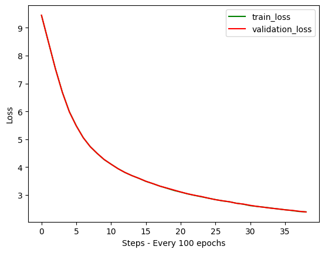

# TinyStories SLM: a 30M-parameter GPT trained from scratch

A small decoder-only transformer (GPT-2 style), written in PyTorch and trained from scratch on the
[TinyStories](https://huggingface.co/datasets/roneneldan/TinyStories) dataset on a single Colab T4.
The training code follows Karpathy's [nanoGPT](https://github.com/karpathy/nanoGPT); the point of the
project was to build every piece myself, run it end to end, and understand what each choice does.

Everything is in one notebook: [`Tiny_Stories_SLM_From_Scratch.ipynb`](Tiny_Stories_SLM_From_Scratch.ipynb).

## Results

All numbers below come from the logged run in the notebook.

| | |
|---|---|
| Parameters | **29,995,392** (~30.0M; 19.3M of it is the token embedding, shared with the output layer) |
| Architecture | 6 layers, 6 heads, 384 dims, 128-token context, pre-LayerNorm, GELU MLP (4x) |
| Tokenizer | GPT-2 BPE via `tiktoken` (50,257 tokens) |
| Training | 20,000 micro-batches of 32 x 128 tokens = **~82M tokens** (about a sixth of the TinyStories train split) |
| Optimizer updates | 625 (gradient accumulation over 32 micro-batches, effective batch 1,024 sequences) |
| Hardware | 1x NVIDIA T4 (Colab), fp16 autocast with `GradScaler` |
| Final loss | train **2.398**, validation **2.395** (validation perplexity ~11.0) |

The loss starts near ln(50,257) = 10.8 and train and validation stay together for the whole run,
so the model is still under-trained, not over-fitting.



### Samples

Prompt: *"Once upon a time there was a pumpkin."*

```text
Once upon a time there was a pumpkin. He was so excited to go outside. He had brave and would
explore. His parents warned him about it. He wasn't so excited and waved.

They grabbed the brick, he started running and laughed. He began to rest, until the Linda was
something gloomy pond. ...
```

Prompt: *"A little dog called Chintu"*

```text
A little dog called Chintu and said, "Hi miles! Aston Birthday worlds. They took a deep breath and
started to give them in half. Mittens gave them a towel and shared the sunshine. ...
```

Sentence-level grammar and the TinyStories register are there; names, pronouns and plot drift
after a sentence or two. That fits a 30M model at loss ~2.4 (models in the TinyStories paper that
produce consistent stories train much longer).

## How it works

- **Data:** the dataset is tokenized once with `encode_ordinary` and written to `train.bin` /
  `validation.bin` as `uint16`, then read with `np.memmap` so the full token stream never sits in
  RAM. Batches are random 128-token windows.
- **Model:** token + learned position embeddings, 6 pre-norm blocks (causal self-attention with
  PyTorch's fused `scaled_dot_product_attention`, then a 4x GELU MLP), final LayerNorm, and an
  output head tied to the token embedding. GPT-2 initialisation, with the residual projections
  scaled by 1/sqrt(2 x layers).
- **Training:** AdamW (betas 0.9/0.95, weight decay 0.1), linear warmup then cosine schedule,
  gradient accumulation, gradient clipping, mixed precision, and the best checkpoint by validation
  loss is kept.

## What I would fix in this run

Re-reading the notebook, the run works but several settings don't do what the comments say.
These are the first things I'd change before training longer:

| Issue | What actually happened | Fix |
|---|---|---|
| `min_lr` (5e-4) is higher than the peak `learning_rate` (1e-4) | The "cosine decay" **raised** the learning rate from 1e-4 to 5e-4 over the run (visible in the logged LR) | Peak around 6e-4 to 1e-3 for this size, `min_lr` about a tenth of that |
| `scheduler.step()` runs on every micro-batch | Warmup of "1,000 steps" lasted ~31 optimizer updates, and the schedule is tied to micro-batches, not updates | Step the scheduler only when the optimizer steps |
| Gradients are clipped before `scaler.unscale_()` | Under fp16 the clip applies to scaled gradients, so `max_norm=0.5` isn't the real threshold | Call `scaler.unscale_(optimizer)` before `clip_grad_norm_` |
| `eval_iters = 500` is both the eval interval and the number of eval batches | Each evaluation runs 1,000 forward passes, a large share of training time | Separate `eval_interval` and `eval_iters` (e.g. 500 and 100) |
| 20,000 micro-batches with accumulation 32 | Only 625 weight updates and ~82M tokens | Count updates, not micro-batches, and train for several thousand updates |

## Next experiments

- Rerun with the fixes above and compare loss at an equal token budget.
- Train a TinyStories-sized tokenizer (a few thousand tokens): with GPT-2's 50K vocab, two thirds
  of the parameters are embeddings.
- Report validation perplexity per token budget, and score samples for grammar and consistency the
  way the TinyStories paper does.

## Reproduce

Open the notebook in Colab with a GPU runtime and run the cells in order. It installs `datasets`
and `tiktoken`, tokenizes TinyStories to disk (a few GB), trains, plots the loss and samples from
the best checkpoint. Library versions are listed in [`requirements.txt`](requirements.txt).

## References

- Eldan & Li (2023), *TinyStories: How Small Can Language Models Be and Still Speak Coherent English?*
- Radford et al. (2019), *Language Models are Unsupervised Multitask Learners* (GPT-2)
- Vaswani et al. (2017), *Attention Is All You Need*
- Loshchilov & Hutter (2019), *Decoupled Weight Decay Regularization* (AdamW)
- Dao et al. (2022), *FlashAttention*
- Karpathy, [nanoGPT](https://github.com/karpathy/nanoGPT): the data preparation and batching code is adapted from it

## Author

Manjunath Irukulla · imanjunad@gmail.com · [LinkedIn](https://www.linkedin.com/in/irumanjunath/)
